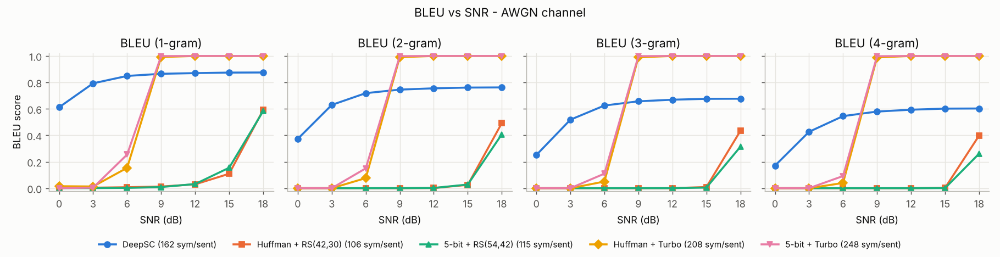
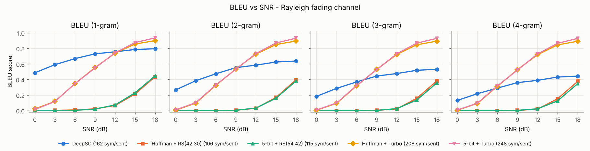
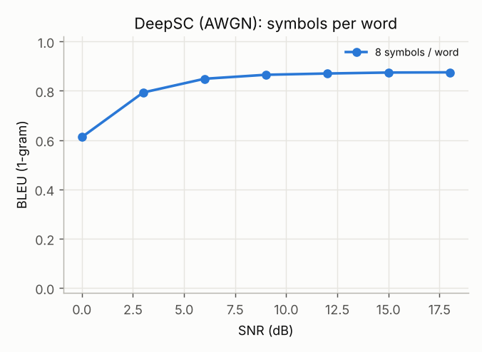
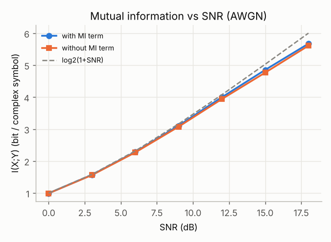
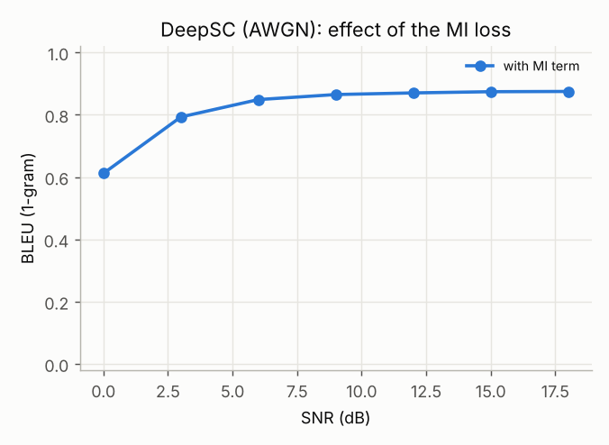
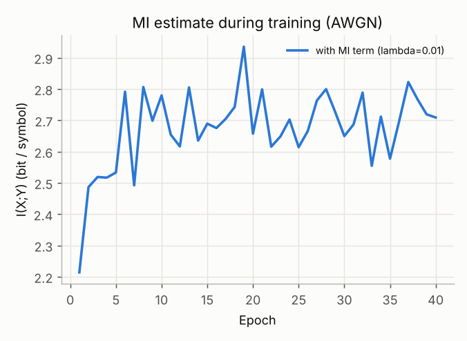
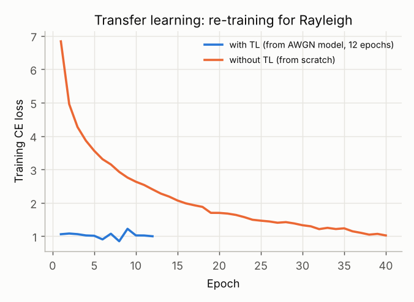
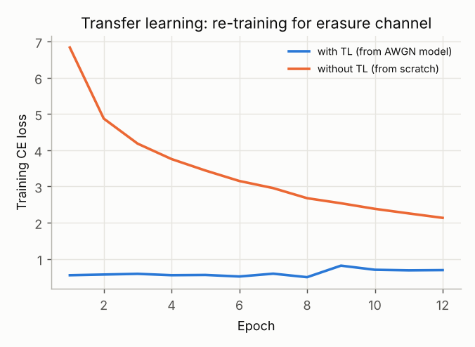
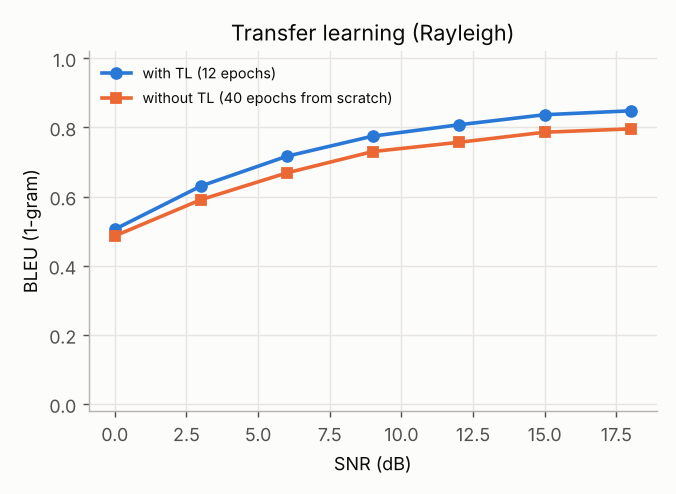
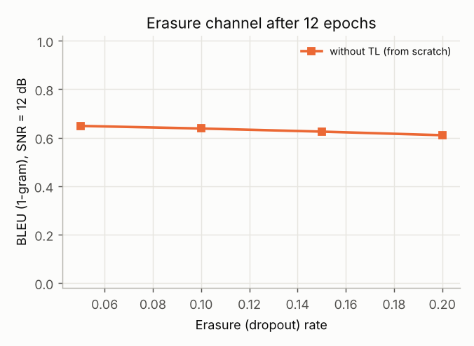

# Project Hub - DeepSC

DeepSC 구현 및 성능 개선을 위한 프로젝트 허브입니다.

| 프로젝트 | 내용 | 주요 결과 |
|---|---|---|
| [**DeepSC-PyTorch**](https://github.com/EHeum/DeepSC-PyTorch) | Xie et al., *"Deep Learning Enabled Semantic Communication Systems,"* IEEE TSP 2021의 시스템 모델 분석과 DeepSC PyTorch 재구현·검증. Huffman/5-bit × RS/Turbo 베이스라인, MI 손실, 전이학습 포함 | AWGN 0 dB BLEU-1 0.61(논문 ≈0.62). 기존 분리 부호화의 cliff effect 대비 완만한 열화 재현 |
| [**DeepSC-Digital**](https://github.com/EHeum/DeepSC-Digital) | DeepJSCC-Q 방식으로 DeepSC 송신 심볼을 M-QAM(4/16/64) 성상점에 제약해 디지털화. soft/hard 수신기, SNR mismatch, cliff 분석 | 64-QAM ≈ analog(12 dB 이상 손실 ≤ 0.003). 디지털화 후에도 cliff 현상 없음 |

> 아래는 프로젝트를 나누기 전의 작업 내용(원본 README)입니다. 앞으로의 개발은 위 두 저장소에서 진행합니다.

---

# DeepSC — Deep Learning Enabled Semantic Communication (PyTorch 재구현)

> H. Xie, Z. Qin, G. Y. Li, B.-H. Juang, **"Deep Learning Enabled Semantic Communication Systems,"**
> *IEEE Trans. Signal Processing*, vol. 69, pp. 2663–2675, 2021.

이 저장소는 위 논문의 시스템 모델을 분석하고, 핵심 기여인 **DeepSC**(Transformer 기반 joint
semantic-channel coding 송수신기)를 Python/PyTorch로 처음부터 구현한 뒤 논문의 주요 실험
(Fig. 6, 8, 9, 10, 13, Table II, III)을 축소된 규모로 재현·검증한 결과를 정리한 것입니다.

---

## 1. 시스템 모델 분석

### 1.1 두 단계(level)로 본 통신 시스템 (Sec. III, Fig. 1)

| 단계 | 역할 | 논문의 대응 블록 |
|---|---|---|
| **Semantic level** | 문장의 *의미*를 추출/복원. 송·수신기는 공통의 *background knowledge*(학습 데이터)를 공유 | semantic encoder `S_β`, semantic decoder `S⁻¹_χ` |
| **Transmission level** | 의미 특징이 물리 채널을 통해 올바르게 전달되도록 보장 | channel encoder `C_α`, channel decoder `C⁻¹_δ` |

논문은 두 종류의 잡음을 구분합니다.

* **Semantic noise (Def. 1)** – 단어/문장의 모호성 때문에 해석이 어긋나는 교란
* **Physical channel noise (Def. 2)** – AWGN, fading, multipath 등에 의한 신호 왜곡

### 1.2 수식 모델 (eq. (1)–(3))

입력 문장 `s = [w_1, …, w_L]`에 대해

```
x  = C_α( S_β(s) )                 x ∈ C^{M×1}         (1)  송신기
y  = h·x + n,  n ~ CN(0, σ_n² I)                       (2)  채널 (AWGN: h=1, Rayleigh: h ~ CN(0,1))
ŝ  = S⁻¹_χ( C⁻¹_δ(y) )                                 (3)  수신기
```

* 코히어런스 시간이 `M`(=한 문장의 심볼 수)이라고 가정 → **문장 단위 block fading**
* 수신기는 **완벽한 CSI**를 가진다고 가정 (Sec. V)
* 채널은 학습 시 역전파가 가능해야 하므로 신경망의 한 "층"으로 구현

### 1.3 손실 함수

**(a) Cross-entropy (eq. (4))** – 의미 수준 오차를 줄이기 위한 문장 복원 손실

```
L_CE(s, ŝ) = − Σ_l q(w_l) log p(w_l) + (1 − q(w_l)) log(1 − p(w_l))
```

**(b) Mutual information (eq. (5)–(10))** – 전송률(용량)을 높이기 위한 손실.
`I(x;y) = D_KL(p(x,y) ‖ p(x)p(y))` 를 Donsker–Varadhan 표현(Theorem 1)으로 하한을 구하고,
그 하한을 신경망 `T`(MINE)로 근사합니다.

```
L_MI(x, y; T) = E_{p(x,y)}[f_T] − log E_{p(x)p(y)}[e^{f_T}]  ≤  I(x; y)        (9),(10)
```

**(c) 전체 손실 (eq. (14))**

```
L_total = L_CE(s, ŝ; α, β, χ, δ) − λ · L_MI(x, y; T, α, β),   0 ≤ λ ≤ 1
```

MI 항은 **송신기(α, β)**에만 그래디언트를 주며, 같은 전력 제약 하에서 채널 입력 분포를
용량에 가깝게 만드는 정규화 항 역할을 합니다.

### 1.4 신경망 구조 (Fig. 2, Table I)

```
S (B×L) ─Embedding→ E (B×L×128) ─3×Transformer Enc(8 heads)→ M (B×L×128)
  ─Dense 256 ReLU → Dense 2N→ reshape → X (B×NL×2 = 복소 NL개) ─Power norm→ Channel
  ─→ Y ─reshape→ (B×L×2N) ─Dense 256 ReLU → Dense 128 ReLU→ M̂ (B×L×128)
  ─3×Transformer Dec(8 heads)→ Dense(Vocab) + Softmax → Ŝ
MI model T : Dense 256 ReLU → Dense 256 ReLU → Dense 1
```

* `N` = 단어(토큰)당 복소 심볼 수. Table I의 channel encoder 출력 16 unit = **단어당 8개 복소 심볼**
  (Fig. 9의 "8 symbols per word"와 일치).
* 송신 심볼 수는 문장 길이에 비례 → **가변 길이 입력/가변 길이 심볼열**.

### 1.5 학습 절차 (Algorithm 1–4, Fig. 4–5)

* **Phase 1 (Alg. 2)** – 송신기를 고정하고 `−L_MI`를 최소화하여 MI 추정 모델 `T` 학습
* **Phase 2 (Alg. 3)** – `T`를 고정하고 `L_total`로 송수신기 전체(α, β, χ, δ) 학습
* 매 미니배치마다 두 단계를 번갈아 수행 (Alg. 1)
* **Transfer learning (Alg. 4, Fig. 5)**
  * 채널이 바뀌면: semantic encoder/decoder를 **고정**하고 channel encoder/decoder만 재학습
  * 배경지식이 바뀌면: channel encoder/decoder를 **고정**하고 semantic encoder/decoder만 재학습
  * 마지막에 전체를 풀어 몇 epoch 미세조정

### 1.6 성능 지표 (Sec. III-C)

* **BLEU** (eq. (11),(12)) – n-gram 정밀도 + brevity penalty. 논문 그림은 각 n에 대한
  *개별* n-gram 점수(1-gram … 4-gram)를 사용
* **Sentence similarity** (eq. (13)) – BERT 문장 임베딩의 코사인 유사도

---

## 2. 구현 (Python / PyTorch)

### 2.1 저장소 구성

```
deepsc/
  data.py        Europarl 전처리(4–30 단어 문장), 어휘집, Dataset
  models.py      DeepSC 송수신기(Fig. 2, Table I), MINE(T 네트워크), eq. (9) MI 하한
  channels.py    AWGN / Rayleigh / Rician / Erasure 채널, 전력 정규화 (eq. (2))
  engine.py      Algorithm 1–4 (MI 모델 학습 ↔ 전체 네트워크 학습, transfer learning), 평가
  metrics.py     BLEU (eq. (11)–(12)), BERT sentence similarity (eq. (13))
  baselines.py   Huffman / 5-bit 소스 부호 + RS / Turbo(log-MAP) 채널 부호 + Gray M-QAM
  constellation.py  M-QAM constellation 제약(soft-to-hard 양자화, DeepJSCC-Q) — 5장
scripts/
  prepare_data.py  eval_baselines.py  train.py  evaluate.py  estimate_mi.py  plot_results.py  run_all.sh
  plot_digital.py  run_digital.sh   (5장 디지털화 실험)
tests/test_deepsc.py   단위 테스트 (shape/전력/SNR/MINE/BLEU/부호기 round-trip)
results/               실험 결과 JSON + 그림
```

### 2.2 논문 ↔ 코드 대응

| 논문 | 코드 |
|---|---|
| `S_β` semantic encoder (Embedding + 3×Transformer enc, 128 dim, 8 heads) | `DeepSC.embedding`, `DeepSC.semantic_encoder` |
| `C_α` channel encoder (Dense 256 ReLU → Dense 16) | `DeepSC.channel_encoder` |
| 전력 제약 / 복소 심볼 변환 (reshape layer) | `DeepSC.transmit`, `channels.power_normalize` |
| 채널 layer `y = h x + n` (eq. (2)) | `channels.awgn / rayleigh / rician / erasure` |
| `C⁻¹_δ` channel decoder (Dense 256 ReLU → Dense 128 ReLU) | `DeepSC.channel_decoder` |
| `S⁻¹_χ` semantic decoder (3×Transformer dec + softmax) | `DeepSC.semantic_decoder`, `DeepSC.prediction` |
| MI 모델 `T` (Dense 256 → 256 → 1) | `models.MINE` |
| `L_MI` (eq. (9)) | `models.mi_lower_bound` |
| `L_total = L_CE − λ L_MI` (eq. (14)) | `engine.train` (phase 2) |
| Algorithm 2 (MI 모델 학습) / Algorithm 3 (전체 학습) | `engine.train` phase 1 / phase 2 |
| Algorithm 4 (transfer learning, 일부 모듈 고정) | `train.py --init … --freeze semantic|channel --unfreeze-epoch k` |
| BLEU / sentence similarity | `metrics.bleu_scores`, `metrics.SentenceSimilarity` |

### 2.3 구현상의 선택과 논문과의 차이 (중요)

| 항목 | 논문 | 본 구현 | 이유 |
|---|---|---|---|
| 데이터셋 | Europarl v7 전체 (≈2.0M 문장) | NLTK `europarl_raw` 영어 샘플 10개 세션 → 4–30 단어, 중복 제거 후 **12,985 문장** (train 11,687 / test 1,298, 어휘 10,200) | 실행 환경에서 statmt.org 접근 불가. `--raw`로 전체 Europarl 사용 가능 |
| 학습량 | 미기재(GPU) | CPU 4코어, 40 epoch, batch 64, Adam lr 1e-3, warm-up 200 step | 계산 자원 |
| 학습 SNR | 미기재 (Fig. 10/11은 12 dB) | 배치마다 SNR ~ U[0, 18] dB | 한 모델로 전 SNR 구간 평가 |
| 심볼 출력층 활성화 | Table I: ReLU | **선형** (이후 전력 정규화) | ReLU면 심볼이 1사분면에 갇혀 신호 공간의 3/4을 버림 |
| MI 모델 마지막 층 | Table I: ReLU | **선형** | DV 하한의 `T`는 실수 전체 값을 가져야 함 |
| 수신단 위치 정보 | 명시 없음 | 채널 디코더 출력에 positional encoding을 더함 | 수신기는 각 N-심볼 블록이 몇 번째 단어 슬롯인지 이미 앎(전송 비용 0). 작은 데이터에서 수렴 속도 개선 |
| 패딩 | – | 패딩 토큰은 전송하지 않음(심볼=0, 전력 계산 제외) | 심볼 수를 공정하게 계산 |
| λ (eq. (14)) | 0 ≤ λ ≤ 1 (값 미기재) | λ = 0.01 | MI 하한(≈2–3 nat)과 CE의 크기 차이를 고려 |
| MI 단위 | 미기재 | 복소 심볼 1개당 (x, y) 쌍, bit | |
| Rayleigh | `h ~ CN(0,1)` | 문장 단위 block fading, 완전 CSI, ZF 등화 `y/h` | 논문 가정(코히어런스 시간 M, perfect CSI) |
| 베이스라인 | Huffman/5-bit/Brotli × RS/Turbo, 8/64/128-QAM, JSCC[22] | Huffman/5-bit × RS(42,30)·RS(54,42)/Turbo(1/3, log-MAP 5회), **64-QAM** | 128-QAM(cross), Brotli(128문장 묶음 압축), BiLSTM JSCC는 생략 |
| Sentence similarity | BERT | 코드만 구현(`metrics.SentenceSimilarity`), **이번 실험에서는 미측정** | 실행 환경에서 BERT 가중치(HuggingFace) 다운로드 불가 |

---

## 3. 검증 결과

모든 수치는 test set 1,298 문장(베이스라인은 처음 500 문장)에 대한 결과입니다.
BLEU는 논문과 같이 **개별 n-gram BLEU**(brevity penalty 포함)입니다.

### 3.1 BLEU vs SNR — DeepSC vs 기존 분리 부호화 (Fig. 6 재현)




**AWGN** (BLEU-1 / BLEU-4)

| 방식 | 심볼/문장 | 0 dB | 3 dB | 6 dB | 9 dB | 12 dB | 15 dB | 18 dB |
|---|---|---|---|---|---|---|---|---|
| **DeepSC** | 162 | **0.61** / **0.17** | **0.79** / **0.43** | **0.85** / **0.54** | 0.86 / 0.58 | 0.87 / 0.59 | 0.87 / 0.60 | 0.87 / 0.60 |
| Huffman + RS(42,30) | 106 | 0.00 / 0.00 | 0.00 / 0.00 | 0.01 / 0.00 | 0.01 / 0.00 | 0.03 / 0.00 | 0.11 / 0.00 | 0.59 / 0.40 |
| 5-bit + RS(54,42) | 115 | 0.00 / 0.00 | 0.00 / 0.00 | 0.00 / 0.00 | 0.01 / 0.00 | 0.03 / 0.00 | 0.15 / 0.00 | 0.58 / 0.26 |
| Huffman + Turbo | 208 | 0.01 / 0.00 | 0.01 / 0.00 | 0.15 / 0.04 | 0.99 / 0.99 | 1.00 / 1.00 | 1.00 / 1.00 | 1.00 / 1.00 |
| 5-bit + Turbo | 248 | 0.00 / 0.00 | 0.00 / 0.00 | 0.25 / 0.09 | 1.00 / 1.00 | 1.00 / 1.00 | 1.00 / 1.00 | 1.00 / 1.00 |

**Rayleigh fading** (BLEU-1 / BLEU-4)

| 방식 | 심볼/문장 | 0 dB | 3 dB | 6 dB | 9 dB | 12 dB | 15 dB | 18 dB |
|---|---|---|---|---|---|---|---|---|
| **DeepSC** | 162 | **0.49** / **0.13** | **0.59** / **0.22** | **0.67** / 0.29 | **0.73** / 0.36 | 0.76 / 0.39 | 0.79 / 0.43 | 0.80 / 0.44 |
| Huffman + RS(42,30) | 106 | 0.00 / 0.00 | 0.00 / 0.00 | 0.01 / 0.00 | 0.02 / 0.00 | 0.07 / 0.02 | 0.21 / 0.15 | 0.44 / 0.37 |
| 5-bit + RS(54,42) | 115 | 0.00 / 0.00 | 0.00 / 0.00 | 0.00 / 0.00 | 0.02 / 0.00 | 0.07 / 0.02 | 0.23 / 0.12 | 0.45 / 0.35 |
| Huffman + Turbo | 208 | 0.02 / 0.00 | 0.12 / 0.09 | 0.35 / 0.31 | 0.55 / 0.53 | 0.74 / 0.72 | 0.86 / 0.85 | 0.90 / 0.89 |
| 5-bit + Turbo | 248 | 0.01 / 0.01 | 0.12 / 0.09 | 0.35 / 0.32 | 0.55 / 0.52 | 0.74 / 0.73 | 0.88 / 0.87 | 0.94 / 0.93 |

**해석**

* **논문의 핵심 주장(저 SNR 영역에서의 강건성)이 재현됨.** AWGN 0 dB에서 DeepSC는 BLEU-1 0.61
  (논문 Fig. 6(a) ≈ 0.62)인 반면, 기존 방식은 모두 ≈ 0입니다. 기존 방식은 SNR이 문턱을 넘으면
  갑자기 완벽해지는 **cliff effect**를 보이고, DeepSC는 **완만하게 열화(graceful degradation)**됩니다.
* **고 SNR에서는 기존 방식(특히 Turbo)이 더 좋음** — 논문도 "SNR > 12 dB에서는 전통적 방식이
  DNN 기반보다 낫다"고 보고합니다. 본 구현의 DeepSC 포화값(AWGN BLEU-1 0.87)은 논문(≈0.92)보다
  낮은데, 학습 문장 수가 논문의 약 0.6%에 불과해 test에만 나오는 단어(test 토큰의 2%)와 희귀어를
  복원하지 못하기 때문입니다(아래 3.7).
* 심볼 수: DeepSC(단어당 8 복소 심볼 → 문장당 162개)는 RS 방식보다 많고 Turbo 방식보다 적은
  심볼을 씁니다. RS보다 적은 심볼을 쓰는 경우는 3.3의 "단어당 4 심볼(≈81개)" 결과를 참고하세요.
* Rayleigh에서 본 구현의 Turbo 베이스라인은 논문 그림보다 훨씬 좋습니다. 본 구현은 문장 단위
  block fading + 완전 CSI + 정확한 soft LLR(잡음분산 `σ²/|h|²`)을 사용하므로, 깊은 페이딩이 걸린
  문장만 실패하기 때문입니다(논문의 베이스라인 구현 세부는 공개되지 않음). 그럼에도 **BLEU-1 기준 9 dB 이하,
  BLEU-4 기준 3 dB 이하에서는 DeepSC가 모든 베이스라인보다 우수**합니다.

### 3.2 복원 문장 예시 (Table II 재현, Rayleigh, SNR = 18 dB)

| 방식 | 문장 |
|---|---|
| 송신 문장 | i would like to finish off by making a general comment on interreg . |
| **DeepSC** | i would like to finish off by making a general comment on interreg . |
| Huffman + RS | i utmra neckeiinscs irh aft hbe rhhuttr a general comms pln interreg . |
| 5-bit + RS | m womdc .mim xo vihi pk!fv!aykea.yng!a geperi. doement!knkintu.rwg z |
| Huffman + Turbo | i would like to finish off by making a general comment on interreg . |

저 SNR(AWGN 0 dB)에서도 DeepSC는 *"but as you will also be aware , we are waiting for a commission
communication on coherence , really , serve the strategic development policy ."* 처럼 문법과
상당 부분의 의미를 유지하는 반면, 기존 방식은 문자 단위로 깨져 읽을 수 없습니다.

### 3.3 단어당 심볼 수의 영향 (Fig. 8)

Fig. 8처럼 단어당 복소 심볼 수 N을 줄이면 BLEU가 떨어집니다. 단어당 4 심볼(문장당 평균 **81개**)은
가장 적은 심볼을 쓰는 RS 베이스라인(106–115개)보다도 적지만, 0–18 dB 전 구간에서 RS 방식보다 우수합니다.

| AWGN BLEU-1 / BLEU-4 | 심볼/문장 | 0 dB | 3 dB | 6 dB | 9 dB | 12 dB | 15 dB | 18 dB |
|---|---|---|---|---|---|---|---|---|
| DeepSC, 8 심볼/단어 | 162 | 0.61 / 0.17 | 0.79 / 0.43 | 0.85 / 0.54 | 0.86 / 0.58 | 0.87 / 0.59 | 0.87 / 0.60 | 0.87 / 0.60 |
| DeepSC, 4 심볼/단어 | 81 | 0.39 / 0.03 | 0.59 / 0.15 | 0.73 / 0.33 | 0.79 / 0.42 | 0.81 / 0.46 | 0.82 / 0.48 | 0.82 / 0.49 |
| Huffman + RS(42,30) | 106 | 0.00 / 0.00 | 0.00 / 0.00 | 0.01 / 0.00 | 0.01 / 0.00 | 0.03 / 0.00 | 0.11 / 0.00 | 0.59 / 0.40 |



### 3.4 Mutual information 손실의 효과 (Fig. 9, 10)

같은 구조·같은 seed로 λ = 0.01(MI 항 사용)과 λ = 0(CE만 사용) 모델을 각각 40 epoch 학습했습니다.
MI는 학습이 끝난 송신기를 고정하고 SNR마다 새 MINE을 1,500 step 학습해 eq. (9)의 하한으로 추정했습니다.

| AWGN | 0 dB | 3 dB | 6 dB | 9 dB | 12 dB | 15 dB | 18 dB |
|---|---|---|---|---|---|---|---|
| I(X;Y) with MI term [bit/심볼] | 0.99 | 1.57 | 2.29 | 3.11 | 4.00 | 4.85 | 5.67 |
| I(X;Y) without MI term | 0.99 | 1.56 | 2.27 | 3.07 | 3.94 | 4.77 | 5.61 |
| Gaussian 입력 용량 log2(1+SNR) | 1.00 | 1.58 | 2.32 | 3.16 | 4.08 | 5.03 | 6.00 |
| BLEU-1 with MI term | **0.61** | **0.79** | **0.85** | **0.86** | **0.87** | **0.87** | **0.87** |
| BLEU-1 without MI term | 0.59 | 0.77 | 0.83 | 0.84 | 0.85 | 0.85 | 0.85 |
| BLEU-4 with MI term | **0.17** | **0.43** | **0.54** | **0.58** | **0.59** | **0.60** | **0.60** |
| BLEU-4 without MI term | 0.15 | 0.38 | 0.49 | 0.53 | 0.54 | 0.55 | 0.55 |





(마지막 그림: 학습 중 phase 1에서 추정한 MI 하한의 epoch 평균. 배치마다 SNR이 무작위이므로 절대값보다 추세를 보는 용도입니다.)

* MI 항을 넣은 모델이 모든 SNR에서 MI가 조금 더 높고(최대 +0.09 bit/심볼, 15 dB), BLEU-1은 약 +0.02,
  BLEU-4는 +0.02–0.05 높습니다. 방향은 논문과 같습니다.
* 다만 **차이는 논문 Fig. 9(같은 MI를 얻는 데 SNR 약 5 dB 차이)보다 훨씬 작습니다.** 본 구현에서는 MI 항이
  없어도 송신 심볼 분포가 이미 Gaussian 용량에 근접하기 때문입니다. 본 구현은 심볼 출력층을 선형으로
  두었는데(2.3절), Table I처럼 ReLU를 쓰면 심볼이 음이 아닌 값으로 제한되어 MI가 크게 떨어지고, 이때
  MI 항의 효과가 커질 것으로 추정합니다(검증하지 않은 가설). 단일 seed라 +0.02 수준의 BLEU 차이는
  seed 간 편차 안에 들 수도 있습니다.

### 3.5 Transfer learning (Algorithm 4, Fig. 13)

AWGN에서 학습된 모델을 불러와 **semantic encoder/decoder를 고정**하고 channel encoder/decoder만
8 epoch 재학습한 뒤, 9 epoch부터 전체를 풀어 4 epoch 미세조정(총 12 epoch)했습니다.

| 새 채널 | 방법 | 1 epoch 후 train CE | 12 epoch 후 train CE | BLEU-1 (평가 조건) |
|---|---|---|---|---|
| Rayleigh | TL (AWGN 모델에서) | **1.06** | 1.00 | 0.51 / 0.72 / 0.81 / **0.85** (0 / 6 / 12 / 18 dB) |
| Rayleigh | 처음부터 (12 epoch) | 6.83 | 2.40 | – |
| Rayleigh | 처음부터 (**40 epoch**) | 6.83 | 1.02 (40 ep) | 0.49 / 0.67 / 0.76 / 0.80 |
| Erasure (p = 0.1) | TL (AWGN 모델에서) | **0.55** | 0.69 | **0.83 / 0.82 / 0.79 / 0.77** (p = 0.05 / 0.1 / 0.15 / 0.2, 12 dB) |
| Erasure (p = 0.1) | 처음부터 (12 epoch) | 6.84 | 2.13 | 0.65 / 0.64 / 0.63 / 0.61 (p = 0.05 / 0.1 / 0.15 / 0.2, 12 dB) |






* 논문 Fig. 13(a),(b)처럼 사전학습 모델을 쓰면 **수렴에 필요한 epoch이 크게 줄어듭니다.** 첫 epoch
  부터 CE가 처음부터 학습한 모델의 40 epoch 수준에 도달합니다.
* 같은 12 epoch에서 TL 모델의 BLEU가 훨씬 높고, Rayleigh에서는 40 epoch 동안 처음부터 학습한
  모델보다도 좋았습니다(18 dB BLEU-1 0.85 vs 0.80). AWGN에서 학습된 semantic 부분이 페이딩
  잡음에 덜 오염된 표현을 학습했기 때문으로 보입니다.

### 3.6 계산량 (Table III)

| | DeepSC (본 구현, CPU, 배치 1, greedy) | 논문 DeepSC (GTX 2060) |
|---|---|---|
| 문장당 처리 시간 | 약 62 ms | 3.27 ms |

CPU에서 다른 학습과 동시에 측정한 값이라 절대값 비교는 의미가 없습니다(참고용).

### 3.7 한계와 해석 시 주의점

* **데이터 규모**: 1.3만 문장/1만 단어 어휘로, 어휘의 절반 가까이가 1회만 등장합니다. 학습 CE(0.49)와
  test CE(1.22, 6 dB)의 차이가 보여주듯 과적합 경향이 있으며, 고 SNR 포화값이 논문보다 낮은 주원인입니다.
  전체 Europarl을 `scripts/prepare_data.py --raw <dir>`로 넣으면 그대로 확장 가능합니다.
* **Sentence similarity(eq. (13))**는 코드만 있고 BERT 가중치를 받을 수 없어 측정하지 못했습니다.
  `pip install transformers` 후 `deepsc.metrics.SentenceSimilarity()`로 계산할 수 있습니다.
* 베이스라인은 논문의 구성을 그대로 따르지 못한 부분(128-QAM, Brotli, JSCC[22])이 있습니다.
* 단일 seed 실험입니다.

---

## 4. 실행 방법

```bash
pip install -r requirements.txt
python3 scripts/prepare_data.py                 # Europarl 샘플 다운로드 + 전처리 (data/europarl_en.json 포함됨)
python3 -m pytest -q tests                      # 단위 테스트

# 학습 (Algorithm 1)
python3 scripts/train.py --channel awgn --epochs 40 --out checkpoints/deepsc_awgn.pt
python3 scripts/train.py --channel rayleigh --epochs 40 --out checkpoints/deepsc_rayleigh.pt
# MI 손실 없이 / 단어당 4 심볼
python3 scripts/train.py --channel awgn --mi-lambda 0 --out checkpoints/deepsc_awgn_nomi.pt
python3 scripts/train.py --channel awgn --symbols-per-word 4 --out checkpoints/deepsc_awgn_sym4.pt
# Transfer learning (Algorithm 4): AWGN 모델 → Rayleigh, semantic 부분 고정 후 9 epoch에 전체 해제
python3 scripts/train.py --channel rayleigh --epochs 12 --init checkpoints/deepsc_awgn.pt \
    --freeze semantic --unfreeze-epoch 9 --out checkpoints/deepsc_rayleigh_tl.pt

# 평가
python3 scripts/evaluate.py --ckpt checkpoints/deepsc_awgn.pt --out results/deepsc_awgn.json
python3 scripts/eval_baselines.py --out results/baselines.json
python3 scripts/estimate_mi.py --ckpts "with MI term=checkpoints/deepsc_awgn.pt,without MI term=checkpoints/deepsc_awgn_nomi.pt"
python3 scripts/plot_results.py
```

전체 실험은 `scripts/run_all.sh` 한 번으로 재현됩니다(CPU 4코어 기준 약 6시간). CUDA GPU가 있으면 자동으로 사용합니다.


---

## 5. DeepSC 디지털화 — constellation 제약 (DeepJSCC-Q 방식)

### 5.1 디지털화 방법 선택

DeepSC의 채널 인코더 출력은 임의의 복소수(analog)여서, 현재 디지털 모뎀(QAM 심볼과 비트
레이블)으로는 바로 보낼 수 없습니다. 디지털화 방법은 크게 세 가지입니다.

| 방법 | 내용 | 장단점 |
|---|---|---|
| (a) 특징 양자화 + 기존 채널 부호 | 의미 특징을 스칼라/벡터 양자화해 비트로 만든 뒤 LDPC/Turbo + QAM 사용 | 기존 표준과 완전히 호환. 하지만 **소스-채널 분리 구조로 돌아가므로** 채널 부호의 문턱 SNR에서 **cliff effect가 다시 생김** |
| (b) 이진화 잠재 + BPSK | 인코더 출력을 ±1로 이진화(예: [22]의 BLSTM JSCC) | (c)에서 M = 2/4인 특수한 경우 |
| **(c) constellation 제약 JSCC (DeepJSCC-Q)** | 인코더 출력 자체를 **고정된 M-QAM 성상점으로 매핑**하고 end-to-end 학습. 별도 채널 부호 없음 | 송신 심볼이 표준 QAM 점이므로 모뎀과 호환되고(각 심볼 = log2 M 비트 레이블), JSCC의 graceful degradation을 유지 |

DeepJSCC-Q(Tung et al., IEEE JSAIT 2022)가 이미지 JSCC에 적용한 (c) 방식을 DeepSC에 그대로
옮겼습니다(`deepsc/constellation.py`).

```
z = C_α(S_β(s))  →  전력 정규화  →  x = Q_C(z) ∈ {c_1, …, c_M}  →  채널  →  y  →  [hard 검출]  →  C⁻¹_δ → S⁻¹_χ
```

* **soft-to-hard 양자화**: 학습 시 순전파는 hard(가장 가까운 성상점), 역전파는 soft assignment
  `x̃ = Σ_k softmax_k(−|z−c_k|² / (T·d_min²)) c_k`의 gradient를 사용합니다
  (`x = x̃ + stopgrad(x̂ − x̃)`, T = 0.5).
  추론 시에는 항상 hard입니다. 즉 **송신 심볼은 학습과 추론 모두에서 100% 성상점 위에 있습니다.**
* 성상점: Gray 매핑 square QAM(4/16/64), 평균 전력 1로 정규화.
* 수신기는 두 가지를 비교했습니다.
  * **soft Rx**: 등화된 y를 그대로 채널 디코더에 입력 (DeepJSCC-Q와 동일)
  * **hard Rx**: y를 가장 가까운 성상점으로 판정(ML 검출)한 뒤 입력 → 송수신 모두 심볼(비트) 단위인
    "완전 디지털" 링크. *디코더는 soft 입력으로 학습된 모델을 그대로 사용했습니다(재학습 안 함).*
* gradient 방식 사전 점검(16-QAM, 2 epoch): soft T = 0.5 / soft T = 0.1 / identity STE의 차이는 작았고,
  DeepJSCC-Q와 같은 soft 방식(T = 0.5)을 채택했습니다.

### 5.2 실험 설정

* **공정 비교(미세조정)**: 3장의 AWGN DeepSC(40 epoch)를 초기값으로, 같은 조건(15 epoch, lr 5e-4,
  학습 SNR ~ U[0, 18] dB, λ = 0.01)으로 **analog / 4-QAM / 16-QAM / 64-QAM** 4개 모델을 학습했습니다.
  analog도 15 epoch을 더 학습해 추가 학습량을 똑같이 맞췄습니다.
* **SNR mismatch(cliff 점검)**: SNR **12 dB 고정**으로 analog와 16-QAM을 처음부터 25 epoch 학습한 뒤,
  학습하지 않은 SNR(−6 ~ 24 dB)에서 평가했습니다.
* 평가 SNR: −6 ~ 24 dB(3 dB 간격). 학습 범위(0–18 dB) 밖도 포함합니다. 기존 분리 부호화 방식도 같은
  범위에서 다시 평가했습니다.
* 모든 모델의 단어당 복소 심볼 수는 8(문장당 평균 162 심볼)로 같습니다.

### 5.3 결과 ① 성능 변동 — analog 대비 (AWGN, BLEU-1 / BLEU-4)


| 방식 | −6 dB | 0 dB | 3 dB | 6 dB | 12 dB | 18 dB | 24 dB |
|---|---|---|---|---|---|---|---|
| Analog DeepSC | 0.22 / 0.00 | 0.65 / 0.21 | 0.81 / 0.46 | 0.86 / 0.57 | 0.88 / 0.62 | 0.88 / 0.63 | 0.89 / 0.63 |
| QAM-64 (soft Rx) | 0.22 / 0.00 | 0.62 / 0.17 | 0.79 / 0.41 | 0.85 / 0.54 | 0.88 / 0.61 | 0.88 / 0.62 | 0.88 / 0.62 |
| QAM-64 (hard Rx) | 0.24 / 0.00 | 0.61 / 0.16 | 0.78 / 0.40 | 0.84 / 0.53 | 0.88 / 0.60 | 0.88 / 0.62 | 0.88 / 0.62 |
| QAM-16 (soft Rx) | 0.23 / 0.00 | 0.62 / 0.17 | 0.78 / 0.38 | 0.84 / 0.52 | 0.87 / 0.58 | 0.87 / 0.60 | 0.87 / 0.60 |
| QAM-16 (hard Rx) | 0.23 / 0.00 | 0.57 / 0.13 | 0.75 / 0.35 | 0.82 / 0.49 | 0.87 / 0.59 | 0.88 / 0.60 | 0.88 / 0.60 |
| QAM-4 (soft Rx) | 0.22 / 0.00 | 0.55 / 0.11 | 0.72 / 0.29 | 0.80 / 0.43 | 0.83 / 0.50 | 0.84 / 0.52 | 0.84 / 0.53 |
| QAM-4 (hard Rx) | 0.20 / 0.00 | 0.46 / 0.05 | 0.68 / 0.23 | 0.81 / 0.45 | 0.84 / 0.53 | 0.84 / 0.53 | 0.84 / 0.53 |
| Huffman + Turbo (64-QAM, 208 심볼) | 0.02 / 0.00 | 0.01 / 0.00 | 0.01 / 0.00 | 0.16 / 0.05 | 1.00 / 1.00 | 1.00 / 1.00 | 1.00 / 1.00 |
| Huffman + RS (64-QAM, 106 심볼) | 0.00 / 0.00 | 0.00 / 0.00 | 0.00 / 0.00 | 0.01 / 0.00 | 0.03 / 0.00 | 0.58 / 0.38 | 1.00 / 1.00 |

**analog 대비 BLEU 변화량** (soft Rx)

| | 0–6 dB 구간 (BLEU-1 / BLEU-4) | 12–24 dB 구간 (BLEU-1 / BLEU-4) |
|---|---|---|
| QAM-64 | −0.01 ~ −0.02 / −0.03 ~ −0.06 | **≈ 0.00 / −0.01** |
| QAM-16 | −0.02 ~ −0.03 / −0.05 ~ −0.08 | −0.01 / −0.03 |
| QAM-4 | −0.06 ~ −0.10 / −0.11 ~ −0.17 | −0.04 / −0.10 ~ −0.11 |

* **64-QAM이면 디지털화 손실이 거의 없습니다**(12 dB 이상에서 BLEU-1 차이 0.003 이하). 손실은
  constellation 차수가 낮을수록, 그리고 **중간 SNR(0–6 dB)**에서 가장 큽니다. 고 SNR에서 남는 손실은
  양자화 왜곡 때문입니다. 4-QAM은 복소 심볼 1개가 2비트만 담을 수 있어(단어당 16비트) 고 SNR에서도
  analog를 따라가지 못합니다.
* **MI로 본 원인** — 학습된 송신기의 I(X;Y)는 analog에서는 SNR과 함께 계속 증가하지만, M-QAM에서는
  log2 M에서 포화됩니다(4-QAM: 12 dB 이상에서 2.00 bit, 16-QAM: 18 dB 이상에서 3.95 bit).
  BLEU가 이미 9–12 dB에서 포화되므로, 16/64-QAM은 이 상한이 거의 문제가 되지 않습니다.

  

  | I(X;Y) [bit/심볼] | 0 dB | 6 dB | 12 dB | 18 dB | 24 dB |
  |---|---|---|---|---|---|
  | analog | 1.00 | 2.28 | 3.96 | 5.64 | 7.18 |
  | 64-QAM | 0.96 | 2.20 | 3.74 | 5.23 | 5.76 |
  | 16-QAM | 1.00 | 2.20 | 3.53 | 3.95 | 3.96 |
  | 4-QAM | 0.97 | 1.82 | 2.00 | 2.00 | 2.00 |

* **디지털화의 부수 효과**

  | | analog | 4-QAM | 16-QAM | 64-QAM |
  |---|---|---|---|---|
  | 성상점 위 심볼 비율 | – | 100 % | 100 % | 100 % |
  | 사용된 성상점 / 레이블 엔트로피 | – | 4 / 2.00 bit | 16 / 3.98 bit | 64 / 5.86 bit |
  | 문장당 전송 비트(=심볼×log2 M) | – | 324 | **648** | 972 |
  | 평균 전력 | 1.000 | 1.000 | 1.018 | 0.958 |
  | PAPR (최대/평균 전력) | **11.3** | 1.0 | 1.8 | 2.4 |

  * 인코더가 성상점을 거의 균일하게 사용합니다(엔트로피 ≈ log2 M). 즉 모든 비트 레이블을 활용합니다.
  * 16-QAM DeepSC의 전송 비트(648 bit/문장)는 Huffman + RS(42,30) + 64-QAM(636 bit/문장)과 거의 같습니다.
    **같은 비트 예산에서 DeepSC는 0–15 dB 내내 BLEU-1 약 0.6 이상인 반면, Huffman + RS는 15 dB 이하에서
    0.12 이하**입니다.
  * analog DeepSC의 PAPR은 11.3(≈10.5 dB)으로 크지만, 디지털화하면 1.0–2.4로 떨어집니다.
    전력 증폭기 측면에서 실질적인 장점입니다.
  * 성상점 사용 분포가 균일하지 않아 평균 전력이 1에서 조금 벗어납니다(16-QAM +0.08 dB, 64-QAM −0.18 dB).
    SNR 축은 성상점의 정격 전력(1) 기준입니다.

### 5.4 결과 ② cliff 현상이 발생하는가?

cliff effect는 "어떤 SNR 문턱 아래에서 성능이 급격히 무너지는 현상"입니다. SNR 3 dB 증가당
BLEU 최대 상승폭과 최대치의 10 % → 90 % 전이 구간 폭으로 정량화했습니다
(`results/digital/cliff_metrics.md`).

| 모델 | 최대 BLEU-1 | 90 % 도달 SNR | 10→90 % 전이 폭 | 3 dB당 최대 상승 (BLEU-1) | 3 dB당 최대 상승 (BLEU-4) |
|---|---|---|---|---|---|
| Analog DeepSC | 0.89 | 2.8 dB | > 8.8 dB | 0.25 | 0.25 |
| QAM-64 (soft / hard Rx) | 0.88 | 3.4 / 3.9 dB | > 9.4 / > 9.9 dB | 0.24 / 0.23 | 0.24 / 0.23 |
| QAM-16 (soft / hard Rx) | 0.87 / 0.88 | 3.6 / 4.6 dB | > 9.6 / > 10.6 dB | 0.23 / 0.21 | 0.22 / 0.21 |
| QAM-4 (soft / hard Rx) | 0.84 | 4.6 / 4.9 dB | > 10.6 / > 10.9 dB | 0.20 / 0.22 | 0.19 / 0.21 |
| Analog, 12 dB 고정 학습 | 0.85 | 5.2 dB | > 11.2 dB | 0.23 | 0.20 |
| QAM-16, 12 dB 고정 학습 (soft / hard Rx) | 0.81 | 5.3 / 5.9 dB | > 11.3 / > 11.9 dB | 0.18 / 0.19 | 0.15 / 0.14 |
| **Huffman + Turbo** | 1.00 | 8.7 dB | **3.9 dB** | **0.83** (6→9 dB) | **0.95** (6→9 dB) |
| **5-bit + RS** | 1.00 | 20.3 dB | **6.7 dB** | **0.43** (15→18 dB) | **0.72** (18→21 dB) |

(">"는 −6 dB에서도 이미 최대치의 10 %를 넘어 전이 구간 하한이 측정 범위 밖이라는 뜻입니다.)


* **constellation을 적용해도 cliff 현상은 발생하지 않았습니다.** 모든 디지털 DeepSC는 analog와 같은
  완만한 S자 곡선을 그립니다. 3 dB당 상승폭은 최대 0.18–0.24로, 분리 부호화 방식(0.43–0.95)의
  1/2–1/4 수준이고, 전이 폭은 10 dB 이상(분리 방식 3.9–6.7 dB)입니다. −6 dB(학습 범위 밖)에서도
  BLEU-1 ≈ 0.22를 유지해 기존 방식(≈ 0)과 다릅니다.
* **hard-decision 수신기(완전 디지털 링크)도 cliff가 없습니다.** 저 SNR에서 soft Rx보다 손실이
  조금 크지만(예: 16-QAM 0 dB에서 0.62 → 0.57, 4-QAM 0 dB에서 0.55 → 0.46), 곡선 모양은 똑같이
  완만합니다. 이유는 다음과 같습니다.
  1. 심볼 오류의 대부분은 **인접 성상점으로의 오류**이고, 인코더 출력이 연속값에서 양자화된 것이므로
     인접 점은 비슷한 특징값을 뜻합니다. 그래서 오류 하나가 문장 전체를 깨지 않고 특징을 조금 흔드는
     정도에 그칠 것으로 봅니다(오류 패턴을 직접 분석하지는 않음).
  2. 엔트로피 부호(Huffman)처럼 **오류가 전파되는 구조가 없고**, 채널 부호처럼 "정정되거나 완전히
     실패하는" 문턱도 없습니다.
* hard Rx에서는 심볼 오류가 사실상 사라지는 SNR(4-QAM ≈ 12 dB, 16-QAM ≈ 15 dB) 이상에서 출력이 **완전히 같아집니다**
  (BLEU가 정확히 평평함). 디지털 링크의 장점(잡음이 완전히 제거됨)입니다. 4-QAM은 6–12 dB에서
  오히려 soft Rx보다 약간 높습니다(12 dB BLEU-4 0.527 vs 0.505).
* **SNR mismatch** — 12 dB에서만 학습한 모델도 그보다 낮은 SNR에서 급락하지 않고 서서히 열화됩니다
  (analog 12 → 3 dB: 0.84 → 0.68, 16-QAM: 0.80 → 0.65). 16-QAM 모델은 −6 dB에서 analog보다
  오히려 높습니다(0.18 vs 0.13). DeepJSCC-Q가 보고한 "constellation 제약 JSCC는 SNR mismatch에서도
  graceful degradation을 유지한다"는 결과와 일치합니다. 다만 고정 SNR 학습 모델은 처음부터 25 epoch만
  학습했으므로 절대 수준은 5.3의 미세조정 모델과 직접 비교할 수 없고, 곡선의 **모양**을 보는 용도입니다.

### 5.5 결론

1. **방법**: DeepSC의 채널 인코더 뒤에 고정 M-QAM으로의 soft-to-hard 양자화 계층을 넣고 end-to-end로
   학습하면(DeepJSCC-Q 방식), 송신 신호를 표준 QAM 심볼/비트 레이블로 만들 수 있습니다. 구조 변경은
   이 계층 하나이며, 학습된 analog 모델에서 미세조정으로 쉽게 전환됩니다.
2. **성능 변동**: 64-QAM ≈ analog(12 dB 이상 BLEU-1 손실 ≤ 0.003), 16-QAM은 −0.01 ~ −0.03(BLEU-1),
   4-QAM은 −0.04 ~ −0.10입니다. 손실은 중간 SNR에서 가장 크고, 고 SNR 상한은 log2 M이 정합니다.
3. **cliff 현상**: 디지털화 후에도 hard-decision 수신기를 써도 **발생하지 않았습니다.** cliff는
   "디지털이라서"가 아니라 **소스 부호화와 채널 부호화를 분리하고 비트 오류를 문턱 이하로 만드는 구조**
   때문에 생깁니다. 반대로 5.1의 (a)처럼 특징을 비트로 바꾼 뒤 별도 채널 부호를 쓰면 cliff가 다시
   생길 것으로 예상합니다(이번에 검증하지 않음).
4. 한계: AWGN만 실험했고(Rayleigh는 미실험), hard Rx 디코더는 재학습하지 않았으며, 단일 seed입니다.
   더 실험해볼 만한 것은 hard Rx 재학습(`--rx-hard`), Rayleigh 채널, constellation 형태 자체의 학습
   (geometric shaping), 비트 레벨 LLR을 입력으로 받는 디코더입니다.

### 5.6 재현

```bash
python3 scripts/train.py --init checkpoints/deepsc_awgn.pt --epochs 15 --lr 5e-4 \
    --constellation qam16 --out checkpoints/dsc_qam16_ft.pt          # qam4 / qam16 / qam64, 생략 시 analog
python3 scripts/evaluate.py --ckpt checkpoints/dsc_qam16_ft.pt --snrs=-6,-3,0,3,6,9,12,15,18,21,24 \
    [--rx-hard] --out results/digital/qam16_ft.json
python3 scripts/plot_digital.py                                       # 그림 + cliff 지표
# 전체: scripts/run_digital.sh (CPU 4코어 약 4시간)
```
