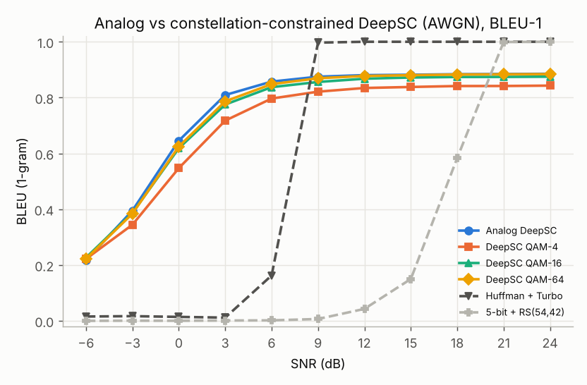
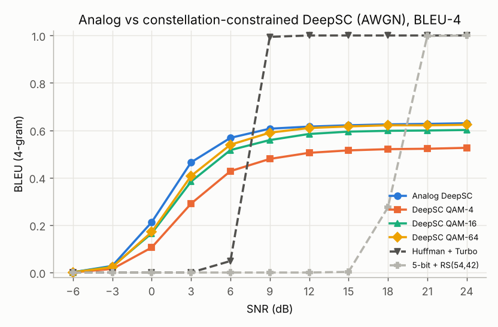
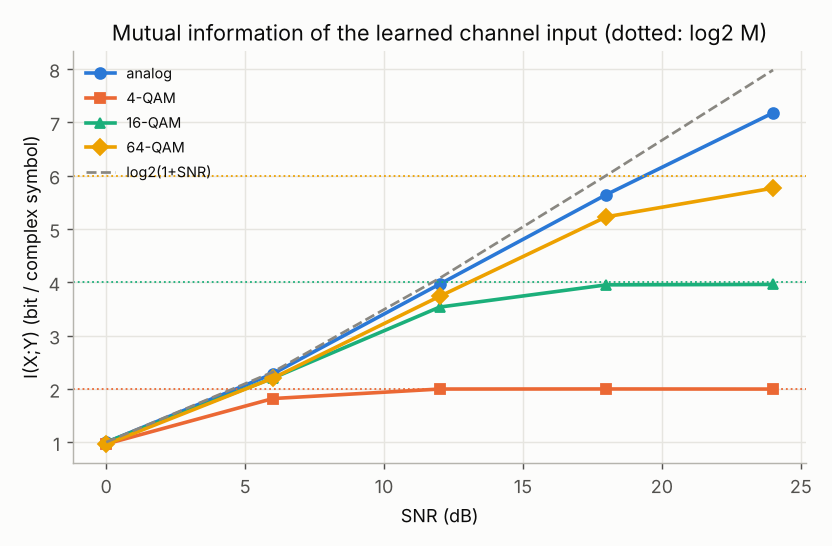
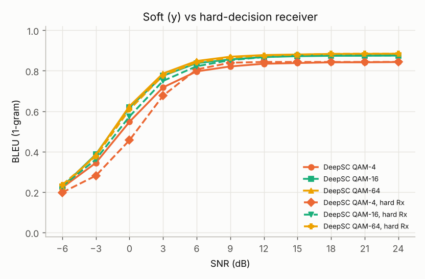
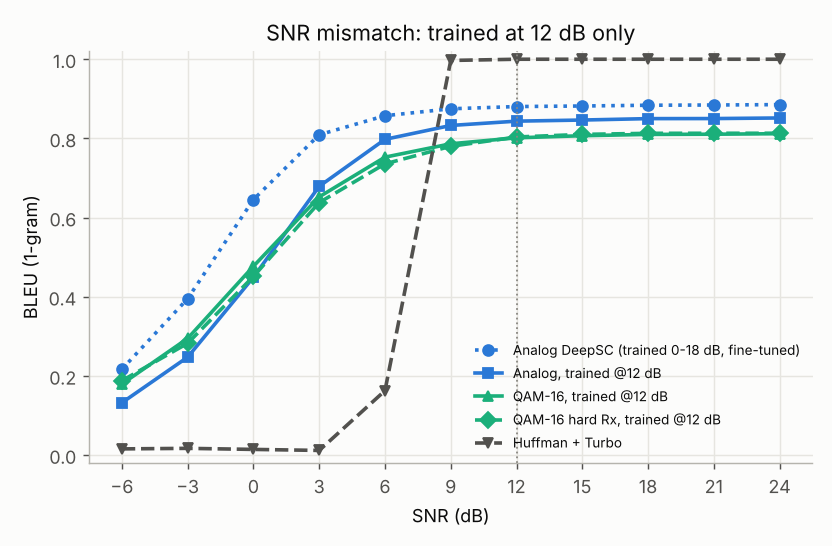

# DeepSC 디지털화 — constellation 제약 (DeepJSCC-Q 방식)

## 1. 디지털화 방법 선택

DeepSC의 채널 인코더 출력은 임의의 복소수(analog)여서, 현재 디지털 모뎀(QAM 심볼과 비트
레이블)으로는 바로 보낼 수 없습니다. 디지털화 방법은 크게 세 가지입니다.

| 방법 | 내용 | 장단점 |
|---|---|---|
| (a) 특징 양자화 + 기존 채널 부호 | 의미 특징을 스칼라/벡터 양자화해 비트로 만든 뒤 LDPC/Turbo + QAM 사용 | 기존 표준과 완전히 호환. 하지만 **소스-채널 분리 구조로 돌아가므로** 채널 부호의 문턱 SNR에서 **cliff effect가 다시 생김** |
| (b) 이진화 잠재 + BPSK | 인코더 출력을 ±1로 이진화(예: [22]의 BLSTM JSCC) | (c)에서 M = 2/4인 특수한 경우 |
| **(c) constellation 제약 JSCC (DeepJSCC-Q)** | 인코더 출력 자체를 **고정된 M-QAM 성상점으로 매핑**하고 end-to-end 학습. 별도 채널 부호 없음 | 송신 심볼이 표준 QAM 점이므로 모뎀과 호환되고(각 심볼 = log2 M 비트 레이블), JSCC의 graceful degradation을 유지 |

DeepJSCC-Q(Tung et al., IEEE JSAIT 2022)가 이미지 JSCC에 적용한 (c) 방식을 DeepSC에 그대로
옮겼습니다(`deepsc/constellation.py`).

```
z = C_α(S_β(s))  →  전력 정규화  →  x = Q_C(z) ∈ {c_1, …, c_M}  →  채널  →  y  →  [hard 검출]  →  C⁻¹_δ → S⁻¹_χ
```

* **soft-to-hard 양자화**: 학습 시 순전파는 hard(가장 가까운 성상점), 역전파는 soft assignment
  `x̃ = Σ_k softmax_k(−|z−c_k|² / (T·d_min²)) c_k`의 gradient를 사용합니다
  (`x = x̃ + stopgrad(x̂ − x̃)`, T = 0.5).
  추론 시에는 항상 hard입니다. 즉 **송신 심볼은 학습과 추론 모두에서 100% 성상점 위에 있습니다.**
* 성상점: Gray 매핑 square QAM(4/16/64), 평균 전력 1로 정규화.
* 수신기는 두 가지를 비교했습니다.
  * **soft Rx**: 등화된 y를 그대로 채널 디코더에 입력 (DeepJSCC-Q와 동일)
  * **hard Rx**: y를 가장 가까운 성상점으로 판정(ML 검출)한 뒤 입력 → 송수신 모두 심볼(비트) 단위인
    "완전 디지털" 링크. *디코더는 soft 입력으로 학습된 모델을 그대로 사용했습니다(재학습 안 함).*
* gradient 방식 사전 점검(16-QAM, 2 epoch): soft T = 0.5 / soft T = 0.1 / identity STE의 차이는 작았고,
  DeepJSCC-Q와 같은 soft 방식(T = 0.5)을 채택했습니다.

## 2. 실험 설정

* **공정 비교(미세조정)**: [논문 재현](01_paper_reproduction.md)의 AWGN DeepSC(40 epoch)를 초기값으로, 같은 조건(15 epoch, lr 5e-4,
  학습 SNR ~ U[0, 18] dB, λ = 0.01)으로 **analog / 4-QAM / 16-QAM / 64-QAM** 4개 모델을 학습했습니다.
  analog도 15 epoch을 더 학습해 추가 학습량을 똑같이 맞췄습니다.
* **SNR mismatch(cliff 점검)**: SNR **12 dB 고정**으로 analog와 16-QAM을 처음부터 25 epoch 학습한 뒤,
  학습하지 않은 SNR(−6 ~ 24 dB)에서 평가했습니다.
* 평가 SNR: −6 ~ 24 dB(3 dB 간격). 학습 범위(0–18 dB) 밖도 포함합니다. 기존 분리 부호화 방식도 같은
  범위에서 다시 평가했습니다.
* 모든 모델의 단어당 복소 심볼 수는 8(문장당 평균 162 심볼)로 같습니다.

## 3. 결과 ① 성능 변동 — analog 대비 (AWGN, BLEU-1 / BLEU-4)




| 방식 | −6 dB | 0 dB | 3 dB | 6 dB | 12 dB | 18 dB | 24 dB |
|---|---|---|---|---|---|---|---|
| Analog DeepSC | 0.22 / 0.00 | 0.65 / 0.21 | 0.81 / 0.46 | 0.86 / 0.57 | 0.88 / 0.62 | 0.88 / 0.63 | 0.89 / 0.63 |
| QAM-64 (soft Rx) | 0.22 / 0.00 | 0.62 / 0.17 | 0.79 / 0.41 | 0.85 / 0.54 | 0.88 / 0.61 | 0.88 / 0.62 | 0.88 / 0.62 |
| QAM-64 (hard Rx) | 0.24 / 0.00 | 0.61 / 0.16 | 0.78 / 0.40 | 0.84 / 0.53 | 0.88 / 0.60 | 0.88 / 0.62 | 0.88 / 0.62 |
| QAM-16 (soft Rx) | 0.23 / 0.00 | 0.62 / 0.17 | 0.78 / 0.38 | 0.84 / 0.52 | 0.87 / 0.58 | 0.87 / 0.60 | 0.87 / 0.60 |
| QAM-16 (hard Rx) | 0.23 / 0.00 | 0.57 / 0.13 | 0.75 / 0.35 | 0.82 / 0.49 | 0.87 / 0.59 | 0.88 / 0.60 | 0.88 / 0.60 |
| QAM-4 (soft Rx) | 0.22 / 0.00 | 0.55 / 0.11 | 0.72 / 0.29 | 0.80 / 0.43 | 0.83 / 0.50 | 0.84 / 0.52 | 0.84 / 0.53 |
| QAM-4 (hard Rx) | 0.20 / 0.00 | 0.46 / 0.05 | 0.68 / 0.23 | 0.81 / 0.45 | 0.84 / 0.53 | 0.84 / 0.53 | 0.84 / 0.53 |
| Huffman + Turbo (64-QAM, 208 심볼) | 0.02 / 0.00 | 0.01 / 0.00 | 0.01 / 0.00 | 0.16 / 0.05 | 1.00 / 1.00 | 1.00 / 1.00 | 1.00 / 1.00 |
| Huffman + RS (64-QAM, 106 심볼) | 0.00 / 0.00 | 0.00 / 0.00 | 0.00 / 0.00 | 0.01 / 0.00 | 0.03 / 0.00 | 0.58 / 0.38 | 1.00 / 1.00 |

**analog 대비 BLEU 변화량** (soft Rx)

| | 0–6 dB 구간 (BLEU-1 / BLEU-4) | 12–24 dB 구간 (BLEU-1 / BLEU-4) |
|---|---|---|
| QAM-64 | −0.01 ~ −0.02 / −0.03 ~ −0.06 | **≈ 0.00 / −0.01** |
| QAM-16 | −0.02 ~ −0.03 / −0.05 ~ −0.08 | −0.01 / −0.03 |
| QAM-4 | −0.06 ~ −0.10 / −0.11 ~ −0.17 | −0.04 / −0.10 ~ −0.11 |

* **64-QAM이면 디지털화 손실이 거의 없습니다**(12 dB 이상에서 BLEU-1 차이 0.003 이하). 손실은
  constellation 차수가 낮을수록, 그리고 **중간 SNR(0–6 dB)**에서 가장 큽니다. 고 SNR에서 남는 손실은
  양자화 왜곡 때문입니다. 4-QAM은 복소 심볼 1개가 2비트만 담을 수 있어(단어당 16비트) 고 SNR에서도
  analog를 따라가지 못합니다.
* **MI로 본 원인** — 학습된 송신기의 I(X;Y)는 analog에서는 SNR과 함께 계속 증가하지만, M-QAM에서는
  log2 M에서 포화됩니다(4-QAM: 12 dB 이상에서 2.00 bit, 16-QAM: 18 dB 이상에서 3.95 bit).
  BLEU가 이미 9–12 dB에서 포화되므로, 16/64-QAM은 이 상한이 거의 문제가 되지 않습니다.

  

  | I(X;Y) [bit/심볼] | 0 dB | 6 dB | 12 dB | 18 dB | 24 dB |
  |---|---|---|---|---|---|
  | analog | 1.00 | 2.28 | 3.96 | 5.64 | 7.18 |
  | 64-QAM | 0.96 | 2.20 | 3.74 | 5.23 | 5.76 |
  | 16-QAM | 1.00 | 2.20 | 3.53 | 3.95 | 3.96 |
  | 4-QAM | 0.97 | 1.82 | 2.00 | 2.00 | 2.00 |

* **디지털화의 부수 효과**

  | | analog | 4-QAM | 16-QAM | 64-QAM |
  |---|---|---|---|---|
  | 성상점 위 심볼 비율 | – | 100 % | 100 % | 100 % |
  | 사용된 성상점 / 레이블 엔트로피 | – | 4 / 2.00 bit | 16 / 3.98 bit | 64 / 5.86 bit |
  | 문장당 전송 비트(=심볼×log2 M) | – | 324 | **648** | 972 |
  | 평균 전력 | 1.000 | 1.000 | 1.018 | 0.958 |
  | PAPR (최대/평균 전력) | **11.3** | 1.0 | 1.8 | 2.4 |

  * 인코더가 성상점을 거의 균일하게 사용합니다(엔트로피 ≈ log2 M). 즉 모든 비트 레이블을 활용합니다.
  * 16-QAM DeepSC의 전송 비트(648 bit/문장)는 Huffman + RS(42,30) + 64-QAM(636 bit/문장)과 거의 같습니다.
    **같은 비트 예산에서 DeepSC는 0–15 dB 내내 BLEU-1 약 0.6 이상인 반면, Huffman + RS는 15 dB 이하에서
    0.12 이하**입니다.
  * analog DeepSC의 PAPR은 11.3(≈10.5 dB)으로 크지만, 디지털화하면 1.0–2.4로 떨어집니다.
    전력 증폭기 측면에서 실질적인 장점입니다.
  * 성상점 사용 분포가 균일하지 않아 평균 전력이 1에서 조금 벗어납니다(16-QAM +0.08 dB, 64-QAM −0.18 dB).
    SNR 축은 성상점의 정격 전력(1) 기준입니다.

## 4. 결과 ② cliff 현상이 발생하는가?

cliff effect는 "어떤 SNR 문턱 아래에서 성능이 급격히 무너지는 현상"입니다. SNR 3 dB 증가당
BLEU 최대 상승폭과 최대치의 10 % → 90 % 전이 구간 폭으로 정량화했습니다
(`results/digital/cliff_metrics.md`).

| 모델 | 최대 BLEU-1 | 90 % 도달 SNR | 10→90 % 전이 폭 | 3 dB당 최대 상승 (BLEU-1) | 3 dB당 최대 상승 (BLEU-4) |
|---|---|---|---|---|---|
| Analog DeepSC | 0.89 | 2.8 dB | > 8.8 dB | 0.25 | 0.25 |
| QAM-64 (soft / hard Rx) | 0.88 | 3.4 / 3.9 dB | > 9.4 / > 9.9 dB | 0.24 / 0.23 | 0.24 / 0.23 |
| QAM-16 (soft / hard Rx) | 0.87 / 0.88 | 3.6 / 4.6 dB | > 9.6 / > 10.6 dB | 0.23 / 0.21 | 0.22 / 0.21 |
| QAM-4 (soft / hard Rx) | 0.84 | 4.6 / 4.9 dB | > 10.6 / > 10.9 dB | 0.20 / 0.22 | 0.19 / 0.21 |
| Analog, 12 dB 고정 학습 | 0.85 | 5.2 dB | > 11.2 dB | 0.23 | 0.20 |
| QAM-16, 12 dB 고정 학습 (soft / hard Rx) | 0.81 | 5.3 / 5.9 dB | > 11.3 / > 11.9 dB | 0.18 / 0.19 | 0.15 / 0.14 |
| **Huffman + Turbo** | 1.00 | 8.7 dB | **3.9 dB** | **0.83** (6→9 dB) | **0.95** (6→9 dB) |
| **5-bit + RS** | 1.00 | 20.3 dB | **6.7 dB** | **0.43** (15→18 dB) | **0.72** (18→21 dB) |

(">"는 −6 dB에서도 이미 최대치의 10 %를 넘어 전이 구간 하한이 측정 범위 밖이라는 뜻입니다.)




* **constellation을 적용해도 cliff 현상은 발생하지 않았습니다.** 모든 디지털 DeepSC는 analog와 같은
  완만한 S자 곡선을 그립니다. 3 dB당 상승폭은 최대 0.18–0.24로, 분리 부호화 방식(0.43–0.95)의
  1/2–1/4 수준이고, 전이 폭은 10 dB 이상(분리 방식 3.9–6.7 dB)입니다. −6 dB(학습 범위 밖)에서도
  BLEU-1 ≈ 0.22를 유지해 기존 방식(≈ 0)과 다릅니다.
* **hard-decision 수신기(완전 디지털 링크)도 cliff가 없습니다.** 저 SNR에서 soft Rx보다 손실이
  조금 크지만(예: 16-QAM 0 dB에서 0.62 → 0.57, 4-QAM 0 dB에서 0.55 → 0.46), 곡선 모양은 똑같이
  완만합니다. 이유는 다음과 같습니다.
  1. 심볼 오류의 대부분은 **인접 성상점으로의 오류**이고, 인코더 출력이 연속값에서 양자화된 것이므로
     인접 점은 비슷한 특징값을 뜻합니다. 그래서 오류 하나가 문장 전체를 깨지 않고 특징을 조금 흔드는
     정도에 그칠 것으로 봅니다(오류 패턴을 직접 분석하지는 않음).
  2. 엔트로피 부호(Huffman)처럼 **오류가 전파되는 구조가 없고**, 채널 부호처럼 "정정되거나 완전히
     실패하는" 문턱도 없습니다.
* hard Rx에서는 심볼 오류가 사실상 사라지는 SNR(4-QAM ≈ 12 dB, 16-QAM ≈ 15 dB) 이상에서 출력이 **완전히 같아집니다**
  (BLEU가 정확히 평평함). 디지털 링크의 장점(잡음이 완전히 제거됨)입니다. 4-QAM은 6–12 dB에서
  오히려 soft Rx보다 약간 높습니다(12 dB BLEU-4 0.527 vs 0.505).
* **SNR mismatch** — 12 dB에서만 학습한 모델도 그보다 낮은 SNR에서 급락하지 않고 서서히 열화됩니다
  (analog 12 → 3 dB: 0.84 → 0.68, 16-QAM: 0.80 → 0.65). 16-QAM 모델은 −6 dB에서 analog보다
  오히려 높습니다(0.18 vs 0.13). DeepJSCC-Q가 보고한 "constellation 제약 JSCC는 SNR mismatch에서도
  graceful degradation을 유지한다"는 결과와 일치합니다. 다만 고정 SNR 학습 모델은 처음부터 25 epoch만
  학습했으므로 절대 수준은 3장의 미세조정 모델과 직접 비교할 수 없고, 곡선의 **모양**을 보는 용도입니다.

## 5. 결론

1. **방법**: DeepSC의 채널 인코더 뒤에 고정 M-QAM으로의 soft-to-hard 양자화 계층을 넣고 end-to-end로
   학습하면(DeepJSCC-Q 방식), 송신 신호를 표준 QAM 심볼/비트 레이블로 만들 수 있습니다. 구조 변경은
   이 계층 하나이며, 학습된 analog 모델에서 미세조정으로 쉽게 전환됩니다.
2. **성능 변동**: 64-QAM ≈ analog(12 dB 이상 BLEU-1 손실 ≤ 0.003), 16-QAM은 −0.01 ~ −0.03(BLEU-1),
   4-QAM은 −0.04 ~ −0.10입니다. 손실은 중간 SNR에서 가장 크고, 고 SNR 상한은 log2 M이 정합니다.
3. **cliff 현상**: 디지털화 후에도 hard-decision 수신기를 써도 **발생하지 않았습니다.** cliff는
   "디지털이라서"가 아니라 **소스 부호화와 채널 부호화를 분리하고 비트 오류를 문턱 이하로 만드는 구조**
   때문에 생깁니다. 반대로 1장의 (a)처럼 특징을 비트로 바꾼 뒤 별도 채널 부호를 쓰면 cliff가 다시
   생길 것으로 예상합니다(이번에 검증하지 않음).
4. 한계: AWGN만 실험했고(Rayleigh는 미실험), hard Rx 디코더는 재학습하지 않았으며, 단일 seed입니다.
   더 실험해볼 만한 것은 hard Rx 재학습(`--rx-hard`), Rayleigh 채널, constellation 형태 자체의 학습
   (geometric shaping), 비트 레벨 LLR을 입력으로 받는 디코더입니다.

## 6. 재현

```bash
python3 scripts/train.py --init checkpoints/deepsc_awgn.pt --epochs 15 --lr 5e-4 \
    --constellation qam16 --out checkpoints/dsc_qam16_ft.pt          # qam4 / qam16 / qam64, 생략 시 analog
python3 scripts/evaluate.py --ckpt checkpoints/dsc_qam16_ft.pt --snrs=-6,-3,0,3,6,9,12,15,18,21,24 \
    [--rx-hard] --out results/digital/qam16_ft.json
python3 scripts/plot_digital.py                                       # 그림 + cliff 지표
# 전체: scripts/run_digital.sh (CPU 4코어 약 4시간)
```
