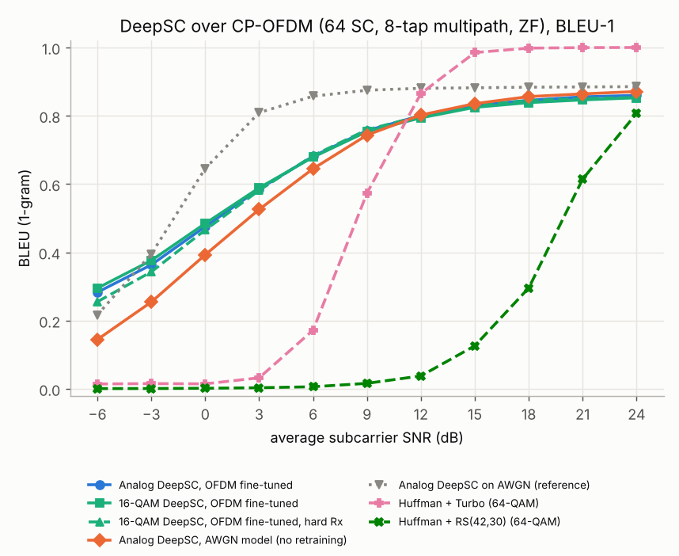
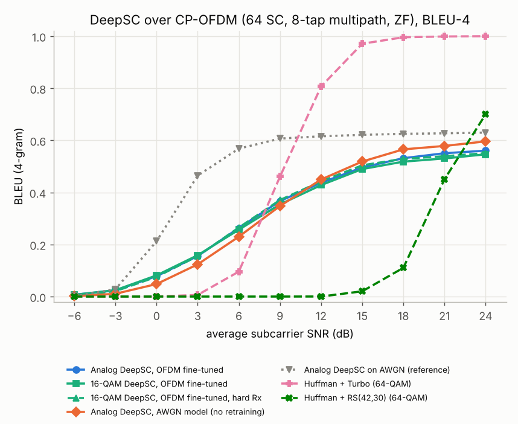
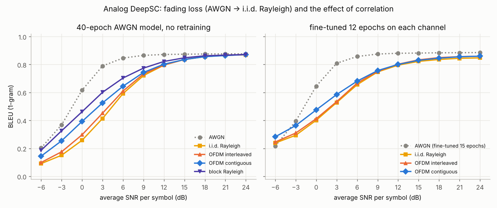
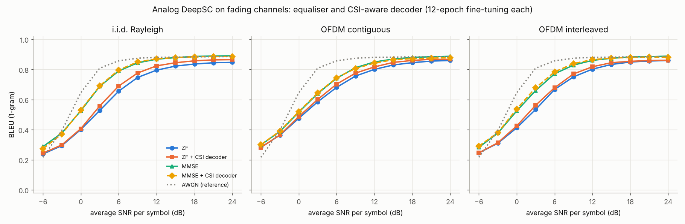

# DeepSC over OFDM — 1단계: 다중경로 채널 + 완전 CSI

analog DeepSC와 디지털(16-QAM) DeepSC의 송신 심볼을 CP-OFDM 부반송파에 실어 주파수 선택적 다중경로 채널로
보냈을 때의 성능입니다. 모델 구조는 바꾸지 않았고, 채널 계층만 `deepsc/channels.py`의 `ofdm`으로 바꿨습니다.

## 1. 시스템

```
x (문장당 L·N 복소 심볼) → 부반송파 64개 × OFDM 심볼 ⌈L·N/64⌉개로 배치 → IFFT(unitary) → CP 16 추가
  → 8탭 Rayleigh 다중경로(지수 감쇠 PDP, 문장 동안 고정) + 시간 영역 AWGN
  → CP 제거 → FFT → 부반송파별 ZF 등화 y_k / H_k (완전 CSI) → x̂ → channel decoder
```

| 항목 | 값 |
|---|---|
| 부반송파 / CP | 64 / 16 (탭 8개 < CP 이므로 ISI 없음) |
| 다중경로 | 8탭, 탭 전력 ∝ exp(−l/2), 총 전력 1. 코히어런스 대역폭이 대략 부반송파 8개 정도 |
| SNR | 부반송파 평균 SNR = 1/N0 (주파수 영역 단위 전력 기준) |
| 심볼 배치 | contiguous: 한 단어의 심볼 8개가 인접 부반송파 8개에 놓임 |
| 등화 | ZF, 완전 CSI (MMSE는 `--ofdm-eq mmse`로 선택 가능) |
| 기존 방식 | 같은 채널의 주파수 영역 등가 모델(부반송파 k에서 H_k X + N), 64-QAM, LLR에 부반송파별 잡음분산 반영 |

학습: AWGN 모델(analog는 40 epoch 모델, 16-QAM은 디지털화 미세조정 모델)에서 시작해 OFDM 채널로 12 epoch 미세조정
(lr 5e-4, 학습 SNR U[0, 18] dB). 평가는 −6 ~ 24 dB, test 1,298문장(기존 방식 500문장). 재현: `scripts/run_ofdm.sh`.

## 2. 결과




**BLEU-1 / BLEU-4**

| 방식 | −6 dB | 0 dB | 3 dB | 6 dB | 9 dB | 12 dB | 18 dB | 24 dB |
|---|---|---|---|---|---|---|---|---|
| Analog DeepSC, OFDM 미세조정 | 0.28 / 0.01 | **0.48** / 0.08 | 0.59 / 0.16 | 0.68 / 0.26 | 0.76 / 0.37 | 0.80 / 0.44 | 0.85 / 0.53 | 0.86 / 0.56 |
| 16-QAM DeepSC, OFDM 미세조정 | **0.30** / 0.01 | **0.49** / 0.08 | 0.59 / 0.16 | 0.68 / 0.26 | 0.75 / 0.35 | 0.79 / 0.43 | 0.84 / 0.52 | 0.85 / 0.55 |
| 16-QAM DeepSC, OFDM 미세조정, hard Rx | 0.26 / 0.00 | 0.47 / 0.08 | 0.58 / 0.16 | 0.68 / 0.27 | 0.76 / 0.37 | 0.80 / 0.44 | 0.85 / 0.53 | 0.85 / 0.55 |
| Analog DeepSC, AWGN 모델 그대로 | 0.14 / 0.00 | 0.39 / 0.05 | 0.53 / 0.12 | 0.65 / 0.23 | 0.74 / 0.35 | 0.80 / 0.45 | 0.86 / 0.57 | 0.87 / 0.60 |
| 16-QAM DeepSC, AWGN 모델 그대로 | 0.17 / 0.00 | 0.41 / 0.05 | 0.53 / 0.12 | 0.65 / 0.22 | 0.75 / 0.35 | 0.80 / 0.44 | 0.85 / 0.56 | 0.87 / 0.59 |
| Huffman + Turbo (64-QAM, 208 심볼) | 0.01 | 0.02 | 0.03 | 0.17 | 0.57 | 0.87 | 1.00 | 1.00 |
| 5-bit + Turbo (64-QAM, 248 심볼) | 0.00 | 0.00 | 0.03 | 0.18 | 0.62 | 0.90 | 1.00 | 1.00 |
| Huffman + RS(42,30) (64-QAM, 106 심볼) | 0.00 | 0.00 | 0.00 | 0.01 | 0.02 | 0.04 | 0.30 | 0.81 |
| *참고: Analog DeepSC on AWGN* | *0.22* | *0.65* | *0.81* | *0.86* | *0.88* | *0.88* | *0.88* | *0.89* |

(기존 방식은 BLEU-1만 표시. DeepSC는 문장당 162 복소 심볼.)

## 3. 해석

* **OFDM 다중경로에서는 AWGN보다 확실히 어렵습니다.** 같은 평균 SNR에서 BLEU-1이 0 dB 0.65 → 0.48, 6 dB 0.86 → 0.68로
  떨어지고, BLEU-1 0.8에 도달하는 데 SNR이 약 9 dB 더 필요합니다(AWGN 3 dB → OFDM 12 dB). ZF 등화 때문에 깊게 페이딩된 부반송파의 잡음이
  증폭되기 때문입니다. 평탄 Rayleigh 결과(0 dB 0.49, 6 dB 0.67)와 비슷한 수준입니다.
* **OFDM으로 미세조정하면 저 SNR에서 크게 좋아집니다.** AWGN 모델을 그대로 쓸 때보다 −6 dB에서 0.14 → 0.28, 0 dB에서
  0.39 → 0.48입니다. 반면 18 dB 이상에서는 AWGN 모델이 0.01 정도 더 높습니다. 12 epoch 미세조정이 저 SNR 쪽 강건성에
  맞춰진 결과로 보입니다.
* **디지털화(16-QAM)해도 OFDM에서 추가 손실이 거의 없습니다.** analog와의 차이가 전 구간 ±0.01 수준입니다(AWGN에서는
  0–6 dB에서 −0.02 ~ −0.03이었음). 다중경로 페이딩이 지배적인 잡음원이라 양자화 손실이 상대적으로 작아진 것으로 봅니다.
  hard 수신기도 −6 dB를 빼면 soft와 같습니다.
* **cliff 현상은 OFDM에서도 없습니다.** DeepSC는 완만한 곡선을 유지하고, 기존 방식은 여전히 문턱에서 급변합니다.
  다중경로 때문에 기존 방식의 문턱이 AWGN 대비 약 3–5 dB 오른쪽으로 이동했습니다.
* **기존 방식과의 교차점:** DeepSC는 9 dB 이하에서 모든 기존 방식보다 낫고(6 dB에서 0.68 vs 0.17–0.18), Turbo는 12 dB부터
  앞섭니다. 이 구간에서 Turbo는 DeepSC보다 심볼을 약 30–50 % 더 씁니다.

## 4. 2단계: interleaving (bit-reversal 부반송파 배치)

`--ofdm-map interleaved`는 OFDM 심볼마다 부반송파를 bit-reversal 순서로 섞습니다. 한 단어의 심볼 8개가 서로
8개 이상 떨어진 부반송파(코히어런스 대역폭 밖)에 놓여 주파수 다이버시티를 얻는 배치입니다. 같은 조건(AWGN 모델에서 12 epoch
미세조정)으로 학습했고, 기존 방식도 같은 배치로 평가했습니다.

| BLEU-1 / BLEU-4 | −6 dB | 0 dB | 3 dB | 6 dB | 9 dB | 12 dB | 18 dB | 24 dB |
|---|---|---|---|---|---|---|---|---|
| Analog, contiguous | **0.28** / 0.01 | **0.48** / **0.08** | **0.59** / **0.16** | **0.68** / 0.26 | 0.76 / 0.37 | 0.80 / 0.44 | 0.85 / 0.53 | 0.86 / 0.56 |
| Analog, interleaved | 0.25 / 0.00 | 0.41 / 0.06 | 0.54 / 0.14 | 0.67 / 0.26 | 0.75 / 0.37 | 0.80 / 0.45 | 0.85 / 0.54 | 0.86 / 0.56 |
| 16-QAM, contiguous | **0.30** / 0.01 | **0.49** / **0.08** | **0.59** / 0.16 | 0.68 / 0.26 | 0.75 / 0.35 | 0.79 / 0.43 | 0.84 / 0.52 | 0.85 / 0.55 |
| 16-QAM, interleaved | 0.25 / 0.00 | 0.43 / 0.06 | 0.56 / 0.15 | 0.67 / 0.26 | 0.75 / 0.37 | 0.79 / 0.44 | 0.84 / 0.52 | 0.85 / 0.54 |
| 16-QAM, interleaved, hard Rx | 0.24 / 0.00 | 0.45 / 0.08 | 0.58 / **0.17** | **0.70** / **0.29** | **0.77** / **0.39** | **0.81** / **0.45** | 0.84 / 0.52 | 0.85 / 0.55 |
| Huffman + Turbo, contiguous | 0.01 | 0.02 | 0.03 | 0.17 | 0.57 | 0.87 | 1.00 | 1.00 |
| Huffman + Turbo, interleaved | 0.02 | 0.01 | 0.03 | 0.15 | 0.59 | 0.90 | 1.00 | 1.00 |
| Huffman + RS(42,30), contiguous | 0.00 | 0.00 | 0.00 | 0.01 | 0.02 | 0.04 | 0.30 | 0.81 |
| Huffman + RS(42,30), interleaved | 0.00 | 0.00 | 0.00 | 0.01 | 0.01 | 0.02 | 0.18 | 0.69 |

* **예상과 반대로, interleaving은 DeepSC 성능을 떨어뜨렸습니다.** 0 dB에서 analog 0.48 → 0.41, 16-QAM 0.49 → 0.43이고,
  6 dB 이상에서는 차이가 거의 없습니다.
* 기존 방식에서는 Turbo가 12 dB에서 0.87 → 0.90으로 조금 좋아졌고, RS는 오히려 나빠졌습니다(18 dB 0.30 → 0.18). RS는 연속된
  바이트 오류(burst)에 강한 부호라서, 오류를 흩뿌리면 오류가 있는 블록이 늘어나기 때문입니다.
* 흥미롭게도 interleaved에서는 16-QAM **hard 수신기가 soft보다 낫습니다**(6 dB 0.70 vs 0.67, contiguous에서는 둘이 같음).
  아래 5장의 해석과 맞는 결과입니다.

## 5. 손실 분해: 페이딩 손실 vs 상관 손실

OFDM이 AWGN 레퍼런스보다 낮은 원인을 나누기 위해 **i.i.d. Rayleigh**(`--channel rayleigh_iid`)를 추가했습니다. 심볼마다
독립적인 h ~ CN(0, 1)을 받고 ZF로 등화합니다. OFDM의 부반송파 이득 H_k도 CN(0, 1)이므로 **심볼 하나만 보면 두 채널의 분포가
같고, 이득 사이의 상관만 다릅니다.**

* AWGN → i.i.d. Rayleigh: **페이딩 손실**
* i.i.d. Rayleigh → OFDM: **상관 손실** (음수면 상관이 오히려 도움이 됨)

### 5.1 채널만 본 다이버시티 (`scripts/fading_diversity.py`)

한 단어(복소 심볼 8개)가 받는 채널 이득을 20만 단어로 계산했습니다.

| 채널 | 인접 심볼 상관 | 단어당 유효 다이버시티 | P(단어 평균 \|h\|² < 0.3) | P(심볼 \|h\|² < 0.1) |
|---|---|---|---|---|
| i.i.d. Rayleigh | 0.00 | 8.0 | 0.3 % | 9.6 % |
| OFDM interleaved | 0.06 | 3.9 | 2.0 % | 9.5 % |
| OFDM contiguous | 0.97 | 1.2 | 19.3 % | 9.4 % |
| block Rayleigh | 1.00 | 1.0 | 25.9 % | 9.5 % |

깊은 페이딩에 걸리는 **심볼의 비율은 네 채널이 모두 같습니다(약 9.5 %).** 다른 것은 깊은 페이딩이 **단어마다 고르게
퍼지는지(i.i.d.), 일부 단어에 몰리는지(contiguous, block)**입니다. 연속 매핑은 사실상 block fading과 같고, interleaving은
채널의 유효 탭 수(약 4개)만큼만 다이버시티를 되찾습니다.

### 5.2 BLEU로 본 분해



**(a) 모델 고정: 40 epoch AWGN 모델을 재학습 없이 각 채널에 사용 (순수한 채널 효과)**

| BLEU-1 | −6 dB | 0 dB | 3 dB | 6 dB | 9 dB | 12 dB | 18 dB | 24 dB |
|---|---|---|---|---|---|---|---|---|
| AWGN | 0.20 | 0.62 | 0.79 | 0.85 | 0.87 | 0.87 | 0.88 | 0.88 |
| i.i.d. Rayleigh | 0.09 | 0.26 | 0.41 | 0.59 | 0.72 | 0.80 | 0.86 | 0.87 |
| OFDM interleaved | 0.10 | 0.30 | 0.45 | 0.61 | 0.73 | 0.80 | 0.86 | 0.87 |
| OFDM contiguous | 0.14 | 0.39 | 0.53 | 0.65 | 0.74 | 0.80 | 0.86 | 0.87 |
| block Rayleigh | 0.19 | 0.46 | 0.60 | 0.70 | 0.77 | 0.82 | 0.86 | 0.87 |
| **페이딩 손실** (AWGN → i.i.d.) | −0.11 | **−0.36** | **−0.38** | −0.25 | −0.14 | −0.08 | −0.02 | −0.01 |
| **상관 손실** (i.i.d. → OFDM contiguous) | +0.05 | **+0.14** | **+0.11** | +0.05 | +0.02 | +0.01 | 0.00 | 0.00 |

**(b) 채널마다 같은 예산(12 epoch)으로 미세조정한 모델**

| BLEU-1 | −6 dB | 0 dB | 3 dB | 6 dB | 9 dB | 12 dB | 18 dB | 24 dB |
|---|---|---|---|---|---|---|---|---|
| AWGN (15 epoch 미세조정, 참고) | 0.22 | 0.65 | 0.81 | 0.86 | 0.88 | 0.88 | 0.88 | 0.89 |
| i.i.d. Rayleigh | 0.24 | 0.40 | 0.53 | 0.66 | 0.75 | 0.80 | 0.84 | 0.85 |
| OFDM interleaved | 0.25 | 0.41 | 0.54 | 0.67 | 0.75 | 0.80 | 0.85 | 0.86 |
| OFDM contiguous | 0.28 | 0.48 | 0.59 | 0.68 | 0.76 | 0.80 | 0.85 | 0.86 |
| 교차: i.i.d.로 학습 → OFDM contiguous에서 평가 | 0.27 | 0.47 | 0.58 | 0.68 | 0.75 | 0.80 | 0.84 | 0.85 |
| 교차: OFDM contiguous로 학습 → i.i.d.에서 평가 | 0.25 | 0.38 | 0.50 | 0.64 | 0.74 | 0.80 | 0.85 | 0.86 |

**결론**

1. **OFDM이 AWGN 레퍼런스보다 낮은 이유는 전부 페이딩 손실입니다.** 0–3 dB에서 BLEU-1이 0.36–0.38 떨어지고(미세조정 후
   0.24–0.28), 12 dB 이상에서는 거의 사라집니다.
2. **상관 손실은 DeepSC에서 음수입니다. 상관이 오히려 성능을 높입니다.** 상관이 강할수록(i.i.d. < interleaved < contiguous
   < block) 저 SNR BLEU가 높고, 연속 매핑 OFDM은 i.i.d. Rayleigh보다 0 dB에서 0.14(미세조정 후 0.07) 높습니다.
   interleaving이 성능을 떨어뜨린 것도 같은 현상입니다.
3. **학습이 아니라 채널 구조가 원인입니다.** 교차 평가에서 어느 채널로 학습했든 평가 채널이 같으면 결과가 거의 같습니다.
4. **원인 해석:** ZF 등화는 깊게 페이딩된 심볼(\|h\|² < 0.1이면 잡음이 10배 이상)의 잡음을 크게 증폭합니다. DeepSC의 channel
   decoder는 한 단어의 심볼 8개를 Dense 층 하나로 함께 처리하므로, 8개 중 하나만 큰 이상치여도 그 단어의 특징 전체가
   망가집니다(약한 고리 효과). i.i.d.·interleaved는 이상치를 **거의 모든 단어에 하나씩** 퍼뜨리고, 상관된 채널은 이상치를
   **일부 단어에 몰아 나머지 단어를 깨끗하게** 남깁니다. 다이버시티는 수신기가 심볼을 신뢰도에 따라 결합할 때만 이득이 되는데,
   지금 구조는 그렇지 않습니다. 근거로, 성상점 판정으로 이상치를 잘라내는 hard 수신기가 interleaved에서만 soft보다 나았습니다(4장).
   반대로 부호화 이득을 쓰는 Turbo는 이론대로 i.i.d.에서 가장 좋았습니다(9 dB 0.72, contiguous OFDM 0.57).

## 6. 수신기 개선: MMSE 등화와 CSI 인지 디코더

5장의 해석(ZF의 잡음 증폭 + 단어 단위 Dense 디코더의 약한 고리 효과)을 검증하려고 수신기를 두 가지로 바꿨습니다.

* **MMSE 등화** (`--eq mmse`): x̂ = conj(h) y / (|h|² + N0). 깊게 페이딩된 심볼은 증폭하지 않고 0 쪽으로 줄입니다.
* **CSI 인지 디코더** (`--csi-rx`): channel decoder 입력에 심볼별 순시 SNR log10(|h|²·SNR)을 추가합니다.
  추가 입력의 가중치는 0으로 시작해, 불러온 직후에는 기존 모델과 출력이 같습니다.

모두 40 epoch AWGN 모델에서 12 epoch 미세조정했습니다(ZF 모델과 같은 조건). 재현: `scripts/run_receiver.sh`.



**BLEU-1 / BLEU-4**

| 채널 | 수신기 | −6 dB | 0 dB | 3 dB | 6 dB | 9 dB | 12 dB | 18 dB | 24 dB |
|---|---|---|---|---|---|---|---|---|---|
| — | AWGN (참고) | 0.22 / 0.00 | 0.65 / 0.21 | 0.81 / 0.47 | 0.86 / 0.57 | 0.88 / 0.61 | 0.88 / 0.62 | 0.88 / 0.63 | 0.89 / 0.63 |
| i.i.d. Rayleigh | ZF | 0.24 / 0.00 | 0.40 / 0.03 | 0.53 / 0.11 | 0.66 / 0.23 | 0.75 / 0.36 | 0.80 / 0.43 | 0.84 / 0.51 | 0.85 / 0.53 |
| | ZF + CSI | 0.24 / 0.00 | 0.41 / 0.04 | 0.56 / 0.13 | 0.69 / 0.27 | 0.78 / 0.40 | 0.82 / 0.49 | 0.86 / 0.56 | 0.87 / 0.57 |
| | **MMSE** | 0.29 / 0.01 | 0.53 / 0.11 | **0.69** / 0.27 | 0.79 / 0.43 | 0.84 / 0.53 | 0.87 / 0.59 | 0.89 / 0.63 | 0.89 / 0.64 |
| | MMSE + CSI | 0.27 / 0.01 | 0.53 / 0.11 | **0.69** / 0.27 | **0.80** / 0.43 | **0.85** / 0.54 | 0.87 / 0.59 | 0.88 / 0.63 | 0.89 / 0.63 |
| OFDM contiguous | ZF | 0.28 / 0.01 | 0.48 / 0.08 | 0.59 / 0.16 | 0.68 / 0.26 | 0.76 / 0.37 | 0.80 / 0.44 | 0.85 / 0.53 | 0.86 / 0.56 |
| | ZF + CSI | 0.28 / 0.01 | 0.49 / 0.09 | 0.60 / 0.18 | 0.70 / 0.30 | 0.78 / 0.40 | 0.82 / 0.47 | 0.86 / 0.57 | 0.87 / 0.59 |
| | MMSE | 0.30 / 0.01 | 0.52 / 0.11 | 0.64 / 0.22 | 0.74 / 0.36 | 0.81 / 0.46 | 0.85 / 0.54 | 0.88 / 0.61 | 0.89 / 0.63 |
| | MMSE + CSI | 0.30 / 0.01 | 0.52 / 0.12 | 0.64 / 0.22 | 0.74 / 0.35 | 0.81 / 0.46 | 0.84 / 0.53 | 0.87 / 0.59 | 0.88 / 0.60 |
| OFDM interleaved | ZF | 0.25 / 0.00 | 0.41 / 0.06 | 0.54 / 0.14 | 0.67 / 0.26 | 0.75 / 0.37 | 0.80 / 0.45 | 0.85 / 0.54 | 0.86 / 0.56 |
| | ZF + CSI | 0.25 / 0.00 | 0.43 / 0.07 | 0.56 / 0.16 | 0.68 / 0.28 | 0.77 / 0.40 | 0.82 / 0.47 | 0.85 / 0.54 | 0.86 / 0.56 |
| | MMSE | 0.28 / 0.01 | 0.53 / 0.14 | 0.66 / 0.26 | 0.77 / 0.41 | 0.83 / 0.50 | 0.86 / 0.57 | 0.88 / 0.62 | 0.89 / 0.63 |
| | MMSE + CSI | 0.29 / 0.01 | **0.54** / **0.15** | 0.68 / **0.28** | 0.78 / 0.42 | 0.84 / 0.52 | 0.87 / 0.58 | 0.88 / 0.61 | 0.88 / 0.62 |

**MMSE에서 다시 계산한 손실 분해 (BLEU-1)**

| | 0 dB | 3 dB | 6 dB | 9 dB | 12 dB | 24 dB |
|---|---|---|---|---|---|---|
| 페이딩 손실 (AWGN → i.i.d.), ZF | −0.24 | −0.28 | −0.20 | −0.13 | −0.09 | −0.04 |
| 페이딩 손실 (AWGN → i.i.d.), **MMSE** | −0.12 | −0.12 | −0.07 | −0.03 | −0.01 | +0.01 |
| 상관 손실 (i.i.d. → OFDM contiguous), ZF | +0.07 | +0.06 | +0.03 | +0.01 | +0.01 | +0.01 |
| 상관 손실 (i.i.d. → OFDM contiguous), **MMSE** | −0.01 | **−0.05** | **−0.05** | −0.03 | −0.02 | 0.00 |
| interleaving 효과 (contiguous → interleaved), MMSE | +0.01 | +0.02 | +0.03 | +0.02 | +0.01 | 0.00 |

**결론**

1. **MMSE가 가장 큰 개선입니다.** 모든 채널에서 ZF보다 좋고, i.i.d. Rayleigh 3 dB에서 0.53 → 0.69, 6 dB에서 0.66 → 0.79입니다.
   페이딩 손실은 절반 이하로 줄고(3 dB −0.28 → −0.12), 12 dB 이상에서는 AWGN 레퍼런스와 거의 같아집니다.
2. **MMSE에서는 상관 효과가 이론대로 뒤집힙니다.** 다이버시티가 클수록 좋아져 i.i.d. > interleaved > contiguous 순이 되고,
   상관 손실이 3–6 dB에서 −0.05로 실제 손실이 됩니다. interleaving은 그중 약 절반(+0.02 ~ +0.03)을 되찾습니다.
   다만 0 dB 이하에서는 세 채널의 차이가 0.02 이내라 효과가 거의 없습니다.
3. **이로써 5장의 해석이 확인됩니다.** ZF에서 상관이 도움이 됐던 것은 채널의 성질이 아니라, ZF가 깊게 페이딩된 심볼의 잡음을
   키워 단어 전체를 망가뜨렸기 때문입니다. 이상치를 억제하는 수신기를 쓰면 다이버시티가 정상적으로 이득이 됩니다.
4. **CSI 인지 디코더는 효과가 작습니다.** ZF에 더하면 0.01–0.04 좋아지지만 MMSE에는 크게 못 미치고, ZF의 순서(contiguous 우위)도
   바꾸지 못합니다. MMSE에 더하면 거의 차이가 없고, interleaved 저 SNR에서만 +0.01–0.02입니다. 12 epoch 미세조정으로는
   디코더가 심볼별 신뢰도 가중을 충분히 학습하지 못했을 수 있습니다(처음부터 학습하거나 더 길게 학습하면 달라질 수 있음).
5. **실용적인 권장 설정은 MMSE + interleaved(또는 i.i.d.에 가까운 다이버시티)**입니다. OFDM에서 0 dB 0.54, 6 dB 0.78로,
   지금까지의 ZF + contiguous(0.48, 0.68)보다 확실히 좋습니다.

## 7. 한계와 다음 단계

* 단일 seed, 하나의 다중경로 프로파일, 완전 CSI·완전 동기 가정입니다. analog 모델만 실험했습니다(16-QAM은 ZF까지).
* 다음 단계 후보:
  1. **파일럿 기반 채널 추정**(LS/MMSE 추정): 추정 오차가 있을 때 MMSE·CSI 디코더가 얼마나 버티는지.
  2. **16-QAM DeepSC + MMSE**: 디지털 모델에서도 같은 결론이 나오는지.
  3. **OFDM PAPR 측정과 클리핑 학습**.
  4. CSI 인지 디코더를 처음부터 학습하거나, 단어 단위 Dense 대신 심볼별 attention으로 신뢰도 가중을 직접 모델링.
